<!-- Generated by .github/readme/build.py. Edit .github/readme/README.template.md and the JSON files there, not this file. -->

<picture><source media="(prefers-color-scheme: dark) and (max-width: 600px)" srcset=".github/readme/head-narrow-dark.svg"><source media="(max-width: 600px)" srcset=".github/readme/head-narrow-light.svg"><source media="(prefers-color-scheme: dark)" srcset=".github/readme/head-dark.svg"></picture>

<a href="https://github.com/Ziuziuk-Denys/Nuvo/releases/latest"><picture><source media="(prefers-color-scheme: dark)" srcset=".github/readme/pill-download-dark.svg"></picture></a>&nbsp; <a href="https://nuvo.quest/donate"><picture><source media="(prefers-color-scheme: dark)" srcset=".github/readme/pill-support-dark.svg"></picture></a>&nbsp; <a href="https://t.me/getnuvo"><picture><source media="(prefers-color-scheme: dark)" srcset=".github/readme/pill-channel-dark.svg"></picture></a>

 

Nuvo is a free, open-source music player for Linux, Windows and macOS. It plays YouTube, SoundCloud and your own files, with synced lyrics, a ten-band equalizer and mixes made on your computer. You never make an account: your library, playlists and history stay in an encrypted database on your machine.

[nuvo.quest](https://nuvo.quest) · [Docs](https://nuvo.quest/docs) · [Install](#install) · [Why Nuvo](#why-nuvo) · [Roadmap](#roadmap)

## New in 0.3.0

- A new interface: a top bar with search in it, the search palette (Ctrl K) and every screen redrawn with our own icons
- Nine themes, Matcha and Blossom among them, with an illustrated app icon for eight
- Wallpapers in both themes: a photo, a GIF or a video
- SoundCloud search, with YouTube and SoundCloud songs ranked in one list
- Imports from Soundiiz, TuneMyMusic, Google Takeout, XSPF and TXT files, and public Yandex Music playlists, albums and tracks by link
- Lyrics made on your computer: every word timed, plain lyrics timed, and lyrics written for songs that have none
- SOCKS5 proxies with a login, and a check of each service through the proxy
- yt-dlp, Deno and ffmpeg download by themselves on every platform
- Last.fm shows the song as now playing, and the Discord status is on by default
- Fixes for the Notch on KDE Plasma and per-track loudness normalization, and SQLCipher 4.20

The full list is in [the release notes](https://github.com/Ziuziuk-Denys/Nuvo/releases/tag/v0.3.0).

## See it

**Search.** Ctrl K opens one field for songs, artists and links, with YouTube and SoundCloud in one ranked list.

 

**Karaoke.** Lyrics light up word by word, in full screen or beside the player.

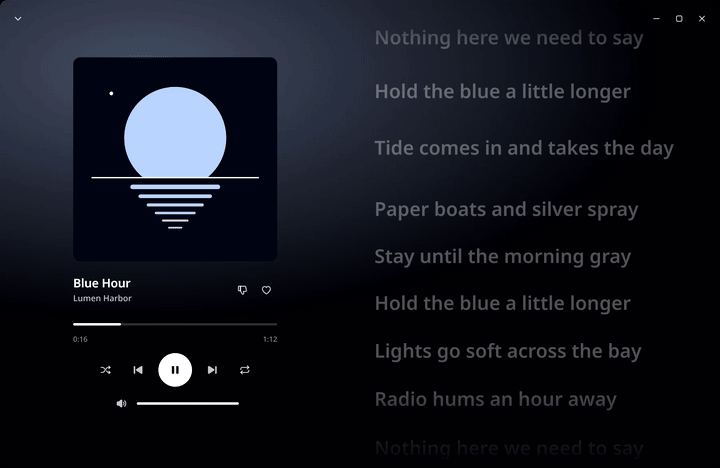

 

**Wallpaper.** A photo, a GIF or a video behind every screen, with the blur and fade you choose.

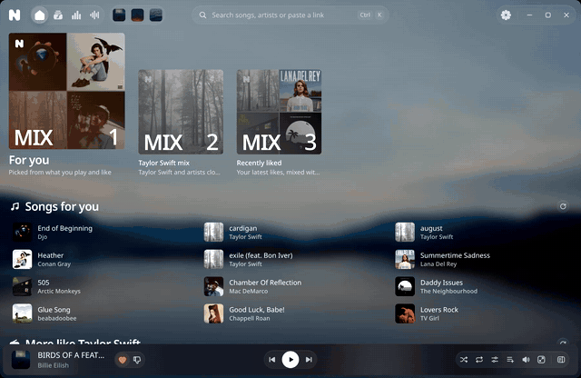

 

**Queue.** It opens beside whatever you are doing, with the history above.

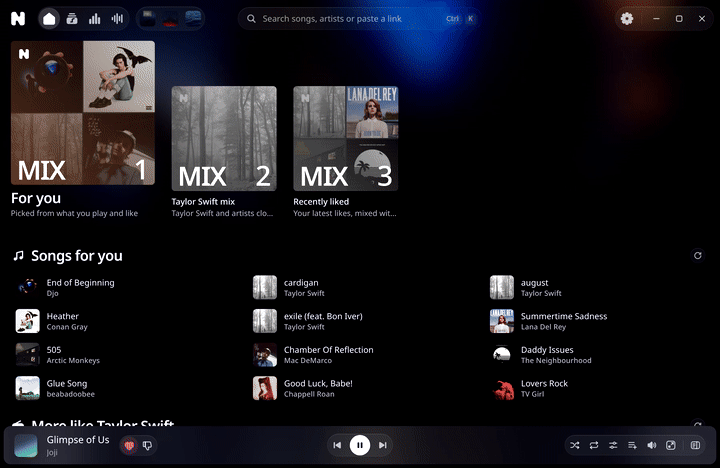

## Features

### Search and play

<picture><source media="(prefers-color-scheme: dark) and (max-width: 600px)" srcset=".github/readme/feature-search-narrow-dark.svg"><source media="(max-width: 600px)" srcset=".github/readme/feature-search-narrow-light.svg"><source media="(prefers-color-scheme: dark)" srcset=".github/readme/feature-search-dark.svg"></picture>

- One field for songs, artists and links, opened with Ctrl K
- YouTube and SoundCloud results in one ranked list
- Paste links from Apple Music, Deezer, Yandex Music, Shazam or TikTok, and share songs and playlists as compact links
- Recognize a song from a video link, a file, the microphone or the sound your computer plays. The last two work on Linux

### Library and mixes

<picture><source media="(prefers-color-scheme: dark) and (max-width: 600px)" srcset=".github/readme/feature-mixes-narrow-dark.svg"><source media="(max-width: 600px)" srcset=".github/readme/feature-mixes-narrow-light.svg"><source media="(prefers-color-scheme: dark)" srcset=".github/readme/feature-mixes-dark.svg"></picture>

- Likes, saved albums and artists, playlists with custom covers, a duplicate finder
- Playlists you can merge, sort six ways, keep offline, restore after a delete and pin
- Mixes and radio from your plays and likes, "Not interested" with undo, a dislike button on every song
- Statistics with a listening history that you can pause, export or delete
- Tags, covers and `.lrc` files read from your folders

### Sound

<picture><source media="(prefers-color-scheme: dark) and (max-width: 600px)" srcset=".github/readme/feature-sound-narrow-dark.svg"><source media="(max-width: 600px)" srcset=".github/readme/feature-sound-narrow-light.svg"><source media="(prefers-color-scheme: dark)" srcset=".github/readme/feature-sound-dark.svg"></picture>

- Gapless playback, crossfade of 1 to 12 seconds, queue, shuffle, repeat
- Loudness normalization, speed and pitch with presets, reverb
- Sleep timer, A-B loop, moments to jump back to, trims for a song's start and end
- Media keys, and MPRIS on Linux

### Lyrics

<picture><source media="(prefers-color-scheme: dark) and (max-width: 600px)" srcset=".github/readme/feature-lyrics-narrow-dark.svg"><source media="(max-width: 600px)" srcset=".github/readme/feature-lyrics-narrow-light.svg"><source media="(prefers-color-scheme: dark)" srcset=".github/readme/feature-lyrics-dark.svg"></picture>

- Synced lyrics and karaoke by line, word, fill or step
- Every word timed on your computer, and lyrics written for songs that have none. The model downloads once, 82 MB
- Paste LRC or plain text and tap to sync, with a timing offset per track
- Romanized lyrics for Korean, Chinese and Japanese kana, and translation through a local model

### Imports

<picture><source media="(prefers-color-scheme: dark) and (max-width: 600px)" srcset=".github/readme/feature-import-narrow-dark.svg"><source media="(max-width: 600px)" srcset=".github/readme/feature-import-narrow-light.svg"><source media="(prefers-color-scheme: dark)" srcset=".github/readme/feature-import-dark.svg"></picture>

- Playlist links from YouTube, SoundCloud, Apple Music, Deezer, Spotify and Yandex Music
- Files: Spotify, Soundiiz, TuneMyMusic and Google Takeout exports, M3U, XSPF, CSV, TXT and Nuvo playlists
- Save streamed tracks as files, original or MP3, and export playlists and the whole library

### Your look

<picture><source media="(prefers-color-scheme: dark) and (max-width: 600px)" srcset=".github/readme/feature-background-narrow-dark.svg"><source media="(max-width: 600px)" srcset=".github/readme/feature-background-narrow-light.svg"><source media="(prefers-color-scheme: dark)" srcset=".github/readme/feature-background-dark.svg"></picture>

- Nine themes, a colour editor with contrast checks, theme files, system or custom fonts
- Custom CSS with a strict checker and a safe mode
- The Notch, a small player at the top of the screen, on Windows, macOS, KDE, Hyprland, Sway and X11. Off until you turn it on
- A panel widget for the GNOME top bar, the Plasma panel and Waybar
- Rebindable shortcuts, window zoom, a reduce-effects switch, English and Russian

### Private by design

<picture><source media="(prefers-color-scheme: dark) and (max-width: 600px)" srcset=".github/readme/feature-lock-narrow-dark.svg"><source media="(max-width: 600px)" srcset=".github/readme/feature-lock-narrow-light.svg"><source media="(prefers-color-scheme: dark)" srcset=".github/readme/feature-lock-dark.svg"></picture>

- Encrypted database and audio cache, a 24-word recovery phrase, an optional passphrase for the key
- A local API on a private socket with a token per launch
- HTTP and SOCKS5 proxies with a login, and a connection check for each service
- Last.fm scrobbling with your own API key, off until you turn it on
- A Discord status with the song cover. On by default; turn it off in Settings, Integrations, Discord
- The update check contacts github.com. On by default; turn it off in Settings, Application, About

## Why Nuvo

Each point links its sources, read on 2026-11-14, and says so when another player matches it.

- **Free, all of it.** Every feature, no plan to pick. Nuvo Plus costs nothing, since it does not exist. Liner Plus costs $4 a month, and Mpthree Plus costs 149 ₽ per 30 days and holds Mpthree's equalizer, effects, crossfade, shortcuts and song recognition. Riff is free too. [Liner pricing](https://tryliner.fun/) · [Mpthree plans](https://mpthree.fun/tariffs) · [Riff FAQ](https://github.com/rootscripts/riff/blob/ac68b13/README.md#faq)
- **The source is right here.** AGPL-3.0-or-later: read it, build it, fork it and share your fork. Liner's licence forbids public forks and any build that talks to a server other than Liner's. Mpthree publishes no source. Riff is open as well, under MIT. [Liner licence](https://github.com/tryliner/desktop/blob/197179b/LICENSE) · [Mpthree terms, 2.1](https://mpthree.fun/legal) · [Riff licence](https://github.com/rootscripts/riff/blob/ac68b13/LICENSE)
- **No account, no Nuvo server.** Your library lives in one file on your machine, so you have no password to forget. Liner keeps your library, playlists and plays on its server under your account, and Mpthree needs an account for Plus. Riff skips the account too. [Liner privacy](https://github.com/tryliner/desktop/blob/197179b/docs/PRIVACY.md) · [Mpthree terms, 7.3](https://mpthree.fun/legal) · [Riff FAQ](https://github.com/rootscripts/riff/blob/ac68b13/README.md#faq)
- **Encrypted, with a way back in.** Nuvo encrypts your library and its audio cache. If the system keyring goes missing, your 24-word recovery phrase opens it. We found no encrypted library or recovery phrase on the official pages of Liner, Riff or Mpthree. [Liner privacy](https://github.com/tryliner/desktop/blob/197179b/docs/PRIVACY.md) · [Liner storage](https://github.com/tryliner/desktop/blob/197179b/docs/STORAGE.md) · [Riff README](https://github.com/rootscripts/riff/blob/ac68b13/README.md) · [Mpthree terms](https://mpthree.fun/legal)
- **The whole sound kit, free.** A ten-band equalizer with twelve presets, speed, pitch and reverb, crossfade, gapless playback and loudness normalization. Mpthree sells its equalizer, speed, reverb and crossfade as Plus. Riff gives you an equalizer, speed, pitch and reverb at no cost. [Mpthree terms, 2.3](https://mpthree.fun/legal) · [Riff README](https://github.com/rootscripts/riff/blob/ac68b13/README.md)
- **Name that song.** Nuvo recognizes a song from a file, a link, your microphone or what your computer plays (the last two on Linux), and keeps a history. Mpthree puts recognition in Plus. Liner and Riff do not document it. [Mpthree terms, 2.3](https://mpthree.fun/legal) · [Liner site](https://tryliner.fun/) · [Riff site](https://riff.hs.vc/)
- **Lyrics for songs that have none.** Nuvo listens to the track and times every word on your computer. Liner, Riff and Mpthree describe online lyrics, LRC files and manual offsets. [Nuvo 0.3.0](https://github.com/Ziuziuk-Denys/Nuvo/releases/tag/v0.3.0) · [Liner site](https://tryliner.fun/) · [Riff README](https://github.com/rootscripts/riff/blob/ac68b13/README.md) · [Mpthree site](https://mpthree.fun/)
- **Bring your library as a file.** Exports from Soundiiz, TuneMyMusic and Google Takeout, Spotify CSV, XSPF and plain text, plus links from Spotify, Apple Music, Deezer, SoundCloud and Yandex Music. Riff takes links, Yandex Music among them, and its own JSON file. Liner takes links. [Nuvo 0.3.0](https://github.com/Ziuziuk-Denys/Nuvo/releases/tag/v0.3.0) · [Riff site](https://riff.hs.vc/) · [Liner privacy](https://github.com/tryliner/desktop/blob/197179b/docs/PRIVACY.md)
- **Statistics that stay yours.** A story of your listening, charts, top lists and drill-downs, which you can export, delete or pause. Liner sends play events to its server for history and recommendations. [Liner privacy](https://github.com/tryliner/desktop/blob/197179b/docs/PRIVACY.md)
- **A proxy built in.** SOCKS5 with a login and a connection check for each service, so you see which one your network blocks. Liner's FAQ points you to a VPN. [Liner FAQ](https://github.com/tryliner/desktop/blob/197179b/docs/FAQ.md)
- **arm64 for Linux and Windows.** Liner 0.2.11, Riff 0.7.5 and Mpthree 1.1.0 list no arm64 build for either system. Pear Desktop does ship them. [Liner 0.2.11](https://github.com/tryliner/desktop/releases/tag/v0.2.11) · [Riff 0.7.5](https://github.com/rootscripts/riff/releases/tag/v0.7.5) · [Mpthree downloads](https://mpthree.fun/) · [Pear Desktop 3.12.0](https://github.com/pear-devs/pear-desktop/releases/tag/v3.12.0)
- **Small tools.** Moments to mark a spot and jump back, an A-B loop, trims for a song's start and end, romanized lyrics, a dislike button on every song and a reason beside each recommendation.

Nuvo 0.3.0 shows text in its window 354 ms after launch, then idles at 364.6 MB and 0.23 % of one core. Strawberry, a native Qt player, needs about a third of that memory, so it stays in the chart.

<picture><source media="(prefers-color-scheme: dark) and (max-width: 600px)" srcset=".github/readme/speed-narrow-dark.svg"><source media="(max-width: 600px)" srcset=".github/readme/speed-narrow-light.svg"><source media="(prefers-color-scheme: dark)" srcset=".github/readme/speed-dark.svg">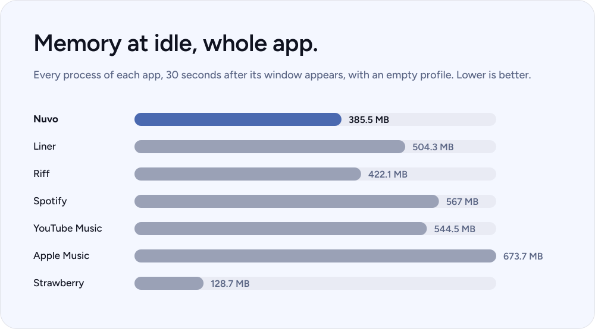</picture>

<b>Every number and how we measured it</b>

 

| App | Idle memory | Processes | Idle CPU | Cold start | Playing CPU | Installed size |
|---|---|---|---|---|---|---|
| Nuvo | 364.6 MB (361.5 to 374.8) | 6 | 0.23 % (0.2 to 0.27) | 354 ms (350 to 364) | 3 % (2.95 to 3.3) | 323.6 MB, unpacked (AppImage 135.3, .deb 106.5) |
| Liner | 504.3 MB (502.2 to 505.1) | 8 | 1.2 % (1.17 to 1.23) | 1053 ms (966 to 1404) | not measured | 549.1 MB |
| Riff | 422.1 MB (421.4 to 422.6) | 7 | 10.87 % (10.67 to 11.2) | 9215 ms, bimodal: 1628 to 9873 ms | not measured | 366.3 MB, extracted (AppImage 132.8) |
| Spotify | 567 MB (558.4 to 568.6) | 9 | 1.5 % (0.43 to 2.07) | no usable-window figure: first window at 435 to 447 ms, probably a splash | not measured | 14.1 MB flatpak app, plus a shared runtime; first-run download not measured |
| YouTube Music | 544.5 MB (533.1 to 547.9) | 17 | 0.6 % (0.3 to 3.23) | 2999 ms (2108 to 4405), includes network | not measured | not measured |
| Apple Music | 673.7 MB (664 to 676.8) | 17 | 0.8 % (0.53 to 3.03) | 3157 ms (2173 to 3741), includes network | not measured | not measured |
| Strawberry | 128.7 MB (128.6 to 129.6) | 2 | 0.37 % (0.3 to 0.37) | 1132 ms (834 to 1342) | 1.3 % (1.27 to 1.37) | 22.6 MB, flatpak app, plus the KDE runtime (about 1.1 GB, shared) |

- **Two dates.** Nuvo 0.3.0 was measured on 2026-11-14, the other apps a week earlier, on 2026-11-07. Same machine, same method, a newer kernel for Nuvo.
- **Machine.** AMD Ryzen 9 PRO 7945, 30 GB, Fedora, GNOME on Wayland. Linux 7.2.11 for the other apps, 7.3.3 for Nuvo.
- **Nuvo 0.3.0.** The Linux x64 build of tag v0.3.0, 5 runs, each on its own empty profile in a separate session with the sound muted. The machine was otherwise quiet, with a load average of about 1.2.
- **Other apps.** 5 runs per figure, 6 for Spotify, each with its own empty profile and no login. Liner: sign-in screen. Riff 44.2.0: logged out. Spotify: logged-out flatpak client. Strawberry 1.2.31: flatpak, empty library. YouTube Music and Apple Music: a web tab, logged out, in a fresh Chrome 156 profile. Each run started a fresh process; the page cache was not dropped.
- **Idle.** Memory is PSS summed over the whole process tree, read 30 s after the window appeared (for Nuvo, 30 s after Home appeared). CPU is user plus system time of the tree over the next 30 s, in percent of one core.
- **Cold start.** The definitions differ, so read it as a rough guide. Nuvo, Liner, Riff and the web tabs: the first frame with the window visible and text; the web-tab figure includes the network. Spotify and Strawberry have no such hook: the first mapped window of at least 200 by 200 pixels.
- **Playing.** Nuvo played a cached 90 s tone, muted, with a 5,000-song playlist open; CPU over seconds 40 to 60. Strawberry played a 240 s tone with its stream volume at 0, measured 30 s after the start. Liner, Spotify, Riff and the web tabs are not measured: playback needs an account, and we did not attempt one.
- **Installed size.** Nuvo: the unpacked Linux x64 build, with the AppImage and .deb sizes from the release.
- **Where Nuvo loses.** Strawberry used 128.7 MB at idle against Nuvo's 364.6 MB, and 1.3 % of one core while playing against 3 %.
- **Published, not measured by us.** Riff's README claims about 180 MB during playback, with no method given ([source](https://github.com/rootscripts/riff#memory-usage), read 2026-11-07). We measured 422 MB at idle on its AppImage.
- **Not measured.** The installed size of the web tabs, a start with a dropped page cache, other machines, Mpthree. Nothing here is estimated.

<picture><source media="(prefers-color-scheme: dark) and (max-width: 600px)" srcset=".github/readme/matrix-narrow-dark.svg"><source media="(max-width: 600px)" srcset=".github/readme/matrix-narrow-light.svg"><source media="(prefers-color-scheme: dark)" srcset=".github/readme/matrix-dark.svg">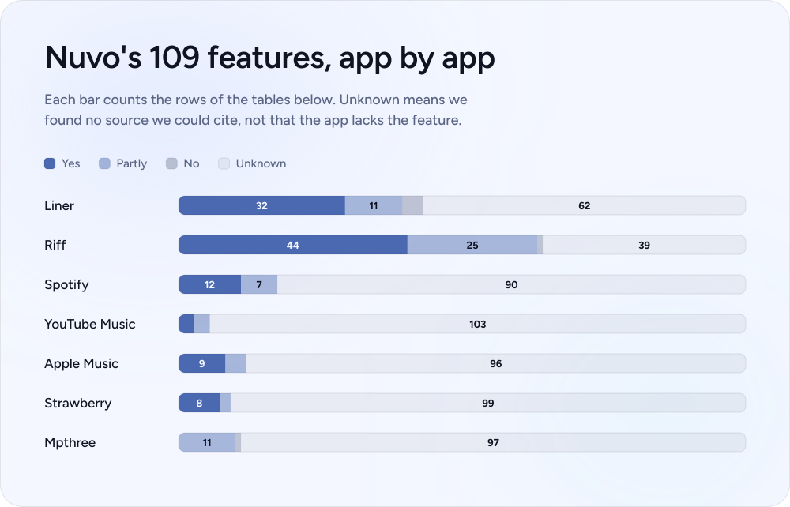</picture>

<b>Every row, app by app</b>

 

#### Playback and sound (22)

| Feature | Nuvo | Liner | Riff | Spotify | YouTube Music | Apple Music | Strawberry | Mpthree |
|---|---|---|---|---|---|---|---|---|
| Now-playing bar with seek, volume and track info | Yes | Yes | Yes | Yes | *unknown* | *unknown* | Yes | *unknown* |
| Queue panel (play next, add to queue) | Yes | Yes | Yes | Yes | *unknown* | Yes | *unknown* | *unknown* |
| Shuffle and repeat (off, all, one) | Yes | Yes | Yes | Yes | *unknown* | Yes | *unknown* | *unknown* |
| Radio from a song or artist | Yes | Yes | Yes | *unknown* | *unknown* | Partly | *unknown* | *unknown* |
| Autoplay similar songs | Yes | Yes | Yes | *unknown* | *unknown* | *unknown* | *unknown* | Partly |
| Crossfade and gapless transitions | Yes | *unknown* | Partly | Yes | *unknown* | Yes | *unknown* | Partly |
| Loudness normalization and auto gain | Yes | *unknown* | Yes | Yes | *unknown* | Yes | Yes | *unknown* |
| Output device choice | Yes | *unknown* | Yes | *unknown* | *unknown* | *unknown* | *unknown* | *unknown* |
| Best quality switch | Yes | *unknown* | Yes | *unknown* | *unknown* | *unknown* | *unknown* | *unknown* |
| 10-band equalizer with 12 presets | Yes | Partly | Partly | Partly | *unknown* | *unknown* | Yes | Partly |
| Speed, pitch and reverb presets (slowed, nightcore, daycore) | Yes | Yes | Yes | Partly | *unknown* | *unknown* | *unknown* | Partly |
| Sleep timer | Yes | *unknown* | Yes | Partly | Yes | *unknown* | *unknown* | *unknown* |
| A-B loop (set start, set end, clear) | Yes | *unknown* | *unknown* | *unknown* | *unknown* | *unknown* | *unknown* | *unknown* |
| Pause on device change | Yes | Yes | *unknown* | *unknown* | *unknown* | *unknown* | *unknown* | *unknown* |
| Click to play or queue, and what plays on launch | Yes | Yes | *unknown* | *unknown* | *unknown* | *unknown* | *unknown* | *unknown* |
| Offline mode | Yes | *unknown* | Yes | *unknown* | *unknown* | *unknown* | *unknown* | *unknown* |
| Saved audio with a cache size limit | Yes | Yes | Yes | Partly | Partly | Partly | Yes | *unknown* |
| Keep this version / Not this one (fix a wrong match) | Yes | *unknown* | *unknown* | *unknown* | *unknown* | *unknown* | *unknown* | *unknown* |
| Media keys and MPRIS | Yes | Partly | Partly | *unknown* | *unknown* | *unknown* | Yes | *unknown* |
| Moments: mark a place in a song and jump back to it | Yes | *unknown* | *unknown* | *unknown* | *unknown* | *unknown* | *unknown* | *unknown* |
| Trim a song's start and end | Yes | *unknown* | Partly | *unknown* | *unknown* | *unknown* | *unknown* | *unknown* |
| Choose which source a song plays from | Yes | *unknown* | *unknown* | *unknown* | *unknown* | *unknown* | *unknown* | *unknown* |

#### Lyrics (9)

| Feature | Nuvo | Liner | Riff | Spotify | YouTube Music | Apple Music | Strawberry | Mpthree |
|---|---|---|---|---|---|---|---|---|
| Synced lyrics pane | Yes | Yes | Yes | Yes | Yes | Yes | *unknown* | Partly |
| Karaoke view | Yes | Yes | Yes | *unknown* | *unknown* | Yes | *unknown* | *unknown* |
| Lyrics timing offset | Yes | Yes | Yes | *unknown* | *unknown* | *unknown* | *unknown* | *unknown* |
| Romanized lyrics | Yes | *unknown* | *unknown* | *unknown* | *unknown* | *unknown* | *unknown* | *unknown* |
| Lyrics editor: paste and time your own lyrics | Yes | *unknown* | Yes | *unknown* | *unknown* | *unknown* | *unknown* | *unknown* |
| Lyrics translation on your machine | Yes | *unknown* | Partly | *unknown* | *unknown* | *unknown* | *unknown* | *unknown* |
| Lyrics version choice (plain, line, word) | Yes | *unknown* | Partly | *unknown* | *unknown* | *unknown* | *unknown* | *unknown* |
| Karaoke highlight modes (line, word, fill, step) | Yes | Partly | Partly | *unknown* | *unknown* | *unknown* | *unknown* | *unknown* |
| Lyrics timed on your machine for songs that have none | Yes | *unknown* | *unknown* | *unknown* | *unknown* | *unknown* | *unknown* | *unknown* |

#### Discovery (13)

| Feature | Nuvo | Liner | Riff | Spotify | YouTube Music | Apple Music | Strawberry | Mpthree |
|---|---|---|---|---|---|---|---|---|
| Mixes on Home (for you, something new, artist mixes) | Yes | Yes | Yes | *unknown* | *unknown* | *unknown* | *unknown* | *unknown* |
| Recently liked and most saved shelves | Yes | *unknown* | Partly | *unknown* | *unknown* | *unknown* | *unknown* | *unknown* |
| Pin to Home | Yes | *unknown* | *unknown* | *unknown* | *unknown* | *unknown* | *unknown* | *unknown* |
| Reasons shown for recommendations | Yes | *unknown* | *unknown* | *unknown* | *unknown* | *unknown* | *unknown* | *unknown* |
| Not interested controls (exact song, any version, artist for a while or always) | Yes | *unknown* | Partly | Partly | Partly | *unknown* | *unknown* | *unknown* |
| Hidden music list with Show again | Yes | *unknown* | Yes | Partly | *unknown* | *unknown* | *unknown* | *unknown* |
| Start with a few artists you like | Yes | *unknown* | Partly | *unknown* | *unknown* | *unknown* | *unknown* | *unknown* |
| Playlist suggestions | Yes | *unknown* | Yes | *unknown* | *unknown* | *unknown* | *unknown* | *unknown* |
| Recognize a song (microphone, this computer or a file) with history | Yes | *unknown* | *unknown* | *unknown* | *unknown* | *unknown* | *unknown* | Partly |
| Statistics page: story, charts, top lists and drill-downs | Yes | *unknown* | *unknown* | *unknown* | *unknown* | *unknown* | *unknown* | Partly |
| Export, delete and pause your statistics | Yes | *unknown* | *unknown* | *unknown* | *unknown* | *unknown* | *unknown* | *unknown* |
| Dislike button on every song | Yes | *unknown* | *unknown* | *unknown* | *unknown* | *unknown* | *unknown* | *unknown* |
| Listening history with filters | Yes | *unknown* | *unknown* | *unknown* | *unknown* | *unknown* | *unknown* | *unknown* |

#### Search, links and sharing (7)

| Feature | Nuvo | Liner | Riff | Spotify | YouTube Music | Apple Music | Strawberry | Mpthree |
|---|---|---|---|---|---|---|---|---|
| Search for songs, albums, artists and playlists | Yes | Yes | Yes | Yes | *unknown* | *unknown* | *unknown* | *unknown* |
| Search history | Yes | Yes | *unknown* | *unknown* | *unknown* | *unknown* | *unknown* | *unknown* |
| Paste a link to play or import (YouTube Music, Apple Music, Deezer, SoundCloud) | Yes | Yes | Yes | *unknown* | *unknown* | *unknown* | *unknown* | *unknown* |
| Song from a TikTok link or video, found by listening | Yes | *unknown* | Partly | *unknown* | *unknown* | *unknown* | *unknown* | *unknown* |
| Share links and copy list | Yes | Yes | *unknown* | Yes | *unknown* | Yes | *unknown* | *unknown* |
| Command palette | Yes | *unknown* | *unknown* | *unknown* | *unknown* | *unknown* | *unknown* | *unknown* |
| Search YouTube and SoundCloud together | Yes | No | Partly | *unknown* | *unknown* | *unknown* | *unknown* | *unknown* |

#### Library and files (28)

| Feature | Nuvo | Liner | Riff | Spotify | YouTube Music | Apple Music | Strawberry | Mpthree |
|---|---|---|---|---|---|---|---|---|
| Library tabs: playlists, albums, artists, on this computer | Yes | Yes | Yes | Yes | *unknown* | *unknown* | *unknown* | Partly |
| Grid and list view with filter | Yes | *unknown* | *unknown* | *unknown* | *unknown* | *unknown* | *unknown* | *unknown* |
| Liked songs | Yes | Yes | Yes | Yes | Yes | *unknown* | *unknown* | *unknown* |
| Create and delete playlists | Yes | Yes | Yes | *unknown* | *unknown* | Yes | Yes | *unknown* |
| Change playlist cover | Yes | *unknown* | Partly | *unknown* | *unknown* | *unknown* | *unknown* | *unknown* |
| Duplicate finder and tidy with undo | Yes | *unknown* | *unknown* | *unknown* | *unknown* | *unknown* | *unknown* | *unknown* |
| Sort tracks by title or length | Yes | Yes | Yes | Yes | *unknown* | Yes | *unknown* | *unknown* |
| Select several songs for bulk actions | Yes | *unknown* | Yes | *unknown* | *unknown* | *unknown* | *unknown* | *unknown* |
| Local music folders with watching and .lrc files | Yes | Partly | Yes | Partly | Partly | Partly | Yes | Partly |
| Import a playlist from a link | Yes | Yes | Yes | *unknown* | *unknown* | *unknown* | *unknown* | *unknown* |
| Import SoundCloud likes | Yes | *unknown* | *unknown* | *unknown* | *unknown* | *unknown* | *unknown* | *unknown* |
| Import a Spotify export file (CSV) | Yes | *unknown* | *unknown* | *unknown* | *unknown* | *unknown* | *unknown* | *unknown* |
| Import report with match review | Yes | Yes | *unknown* | *unknown* | *unknown* | *unknown* | *unknown* | *unknown* |
| Export playlists as CSV, JSON or M3U8 | Yes | *unknown* | Partly | *unknown* | *unknown* | *unknown* | *unknown* | *unknown* |
| Export the library as CSV or JSON | Yes | *unknown* | Partly | *unknown* | *unknown* | *unknown* | *unknown* | *unknown* |
| Save songs as files | Yes | Partly | Yes | *unknown* | *unknown* | *unknown* | *unknown* | *unknown* |
| Artist page | Yes | Yes | Partly | *unknown* | *unknown* | *unknown* | *unknown* | *unknown* |
| Album page | Yes | Yes | Yes | *unknown* | *unknown* | *unknown* | *unknown* | *unknown* |
| YouTube account sign-in, playback and playlist sync | Yes | Yes | Yes | *unknown* | *unknown* | *unknown* | *unknown* | *unknown* |
| Import a Spotify playlist or album from its link | Yes | Partly | Partly | *unknown* | *unknown* | *unknown* | *unknown* | *unknown* |
| Keep a playlist offline | Yes | *unknown* | *unknown* | *unknown* | *unknown* | *unknown* | *unknown* | *unknown* |
| Merge playlists and move songs between them, with undo | Yes | *unknown* | *unknown* | *unknown* | *unknown* | *unknown* | *unknown* | *unknown* |
| Recently deleted playlists with Restore | Yes | *unknown* | *unknown* | *unknown* | *unknown* | *unknown* | *unknown* | *unknown* |
| Save format: original or MP3 | Yes | *unknown* | Partly | *unknown* | *unknown* | *unknown* | *unknown* | *unknown* |
| Pin a playlist, album or artist to the sidebar | Yes | *unknown* | *unknown* | *unknown* | *unknown* | *unknown* | *unknown* | *unknown* |
| Explicit mark on songs their source calls explicit | Yes | *unknown* | *unknown* | *unknown* | *unknown* | *unknown* | *unknown* | *unknown* |
| Import files from Soundiiz, TuneMyMusic, Google Takeout, XSPF or plain text | Yes | *unknown* | *unknown* | *unknown* | *unknown* | *unknown* | *unknown* | *unknown* |
| Import a Yandex Music playlist from its link | Yes | *unknown* | Yes | *unknown* | *unknown* | *unknown* | *unknown* | *unknown* |

#### Look and feel (18)

| Feature | Nuvo | Liner | Riff | Spotify | YouTube Music | Apple Music | Strawberry | Mpthree |
|---|---|---|---|---|---|---|---|---|
| Theme presets (nine) | Yes | Yes | Yes | *unknown* | *unknown* | *unknown* | *unknown* | Partly |
| Accent from the cover | Yes | *unknown* | Yes | *unknown* | *unknown* | *unknown* | *unknown* | *unknown* |
| Cover glow | Yes | Partly | Partly | *unknown* | *unknown* | *unknown* | *unknown* | *unknown* |
| Language choice (English, Russian) | Yes | Yes | Yes | Yes | *unknown* | *unknown* | Yes | *unknown* |
| Fonts and interface size | Yes | *unknown* | Yes | *unknown* | *unknown* | *unknown* | *unknown* | *unknown* |
| Theme editor with colour roles | Yes | *unknown* | Yes | *unknown* | *unknown* | *unknown* | *unknown* | *unknown* |
| Theme import and export | Yes | *unknown* | Partly | *unknown* | *unknown* | *unknown* | *unknown* | *unknown* |
| Custom CSS | Yes | *unknown* | Yes | *unknown* | *unknown* | *unknown* | *unknown* | *unknown* |
| Wallpaper with blur and dimming | Yes | Partly | Yes | *unknown* | *unknown* | *unknown* | *unknown* | *unknown* |
| Reset customization and safe mode | Yes | Partly | Partly | *unknown* | *unknown* | *unknown* | *unknown* | *unknown* |
| The Notch (mini player with lyrics and pulse) | Yes | Partly | Partly | *unknown* | *unknown* | Partly | *unknown* | *unknown* |
| Keep running in the tray | Yes | *unknown* | Yes | *unknown* | *unknown* | *unknown* | *unknown* | *unknown* |
| Rebindable shortcuts, in the app and global | Yes | Yes | Yes | *unknown* | *unknown* | *unknown* | Partly | Partly |
| Guided first-run tour | Yes | *unknown* | *unknown* | *unknown* | *unknown* | *unknown* | *unknown* | *unknown* |
| Reduce effects | Yes | *unknown* | *unknown* | *unknown* | *unknown* | *unknown* | *unknown* | *unknown* |
| Window zoom from the keyboard | Yes | *unknown* | *unknown* | *unknown* | *unknown* | *unknown* | *unknown* | *unknown* |
| Panel widget for GNOME, Plasma and Waybar | Yes | *unknown* | *unknown* | *unknown* | *unknown* | *unknown* | *unknown* | *unknown* |
| Wallpaper: photo, GIF or video | Yes | Partly | Partly | *unknown* | *unknown* | *unknown* | *unknown* | *unknown* |

#### Privacy and system (12)

| Feature | Nuvo | Liner | Riff | Spotify | YouTube Music | Apple Music | Strawberry | Mpthree |
|---|---|---|---|---|---|---|---|---|
| Encrypted library with recovery phrase unlock | Yes | No | *unknown* | *unknown* | *unknown* | *unknown* | *unknown* | *unknown* |
| Passphrase protection when no system keyring exists | Yes | No | *unknown* | *unknown* | *unknown* | *unknown* | *unknown* | *unknown* |
| Proxy setting | Yes | *unknown* | Partly | *unknown* | *unknown* | *unknown* | *unknown* | *unknown* |
| Connection check and report | Yes | Yes | Yes | *unknown* | *unknown* | *unknown* | *unknown* | *unknown* |
| Helper tools download (yt-dlp, ffmpeg) | Yes | *unknown* | Yes | *unknown* | *unknown* | *unknown* | *unknown* | *unknown* |
| Automatic updates | Yes | Yes | Yes | *unknown* | *unknown* | *unknown* | *unknown* | *unknown* |
| Last.fm scrobbling | Yes | *unknown* | *unknown* | *unknown* | *unknown* | *unknown* | *unknown* | *unknown* |
| Discord status switch | Yes | Yes | Partly | *unknown* | *unknown* | *unknown* | *unknown* | *unknown* |
| What's new after an update | Yes | *unknown* | *unknown* | *unknown* | *unknown* | *unknown* | *unknown* | *unknown* |
| Report a problem with a filled GitHub issue | Yes | *unknown* | *unknown* | *unknown* | *unknown* | *unknown* | *unknown* | *unknown* |
| SOCKS5 proxy with login and a per-service check | Yes | *unknown* | *unknown* | *unknown* | *unknown* | *unknown* | *unknown* | *unknown* |
| arm64 builds for Linux and Windows | Yes | No | No | *unknown* | *unknown* | *unknown* | Partly | No |

<b>Notes and sources</b>

 

- Unknown means we found no source we could cite. It does not mean the app lacks the feature, and it is never counted as a no.
- Yes and Partly cells have a source in .github/readme/comparison-sources.json. No cells rest on a repository we read or a limit the product's own docs state.
- Liner cells come from its README, docs and website at commit 197179b, and Riff cells from its README at ac68b13 and riff.hs.vc, all read on 2026-11-14. Older cells keep their 2026-11-07 sources. On 2026-11-14 we turned 14 Liner and Riff cells whose earlier source was never recorded into unknown.
- Mpthree cells come from mpthree.fun, its tariffs and its terms (in Russian, updated 2026-11-07), read on 2026-11-14. Mpthree Plus costs 149 ₽ per 30 days; features that need Plus are marked Partly.
- Spotify, YouTube Music and Apple Music cells come from their help pages, except three cells sourced from SlashGear. Several rows carry over from an earlier pass whose source was not recorded; they are marked in the sources file.
- Nuvo cells describe the app on Linux, its main platform. The Windows and macOS builds are the same app, except that MPRIS, the panel widgets and recognition from the microphone or system sound are Linux only. Rows added on 2026-11-08 carry yes for Nuvo and unknown for the others: we did not look for them elsewhere.
- The rows are the features of the Nuvo app, so they favour Nuvo by construction. A feature another app has and Nuvo lacks is not listed here.

Checked 2026-11-14. Sources: [Riff](https://github.com/rootscripts/riff), [Liner](https://github.com/tryliner/desktop), [Strawberry](https://github.com/strawberrymusicplayer/strawberry), [Mpthree](https://mpthree.fun/), [Spotify help](https://support.spotify.com/), [YouTube Music help](https://support.google.com/youtubemusic), [Apple Music guide](https://support.apple.com/guide/music-windows/). Every cell has its source in [comparison-sources.json](.github/readme/comparison-sources.json). If a cell is wrong, open an issue.

## Install

<picture><source media="(prefers-color-scheme: dark) and (max-width: 600px)" srcset=".github/readme/platforms-narrow-dark.svg"><source media="(max-width: 600px)" srcset=".github/readme/platforms-narrow-light.svg"><source media="(prefers-color-scheme: dark)" srcset=".github/readme/platforms-dark.svg">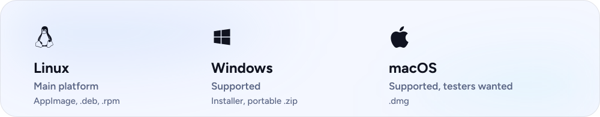</picture>

Get the files from [the latest release](https://github.com/Ziuziuk-Denys/Nuvo/releases/latest).

- **Linux:** AppImage, `.deb` or `.rpm`, for x64 and arm64. Nuvo keeps its key in a Secret Service keyring such as GNOME Keyring or KWallet. Without one, the key stays in a file that you can seal with a passphrase in Settings, Application, Storage. On a Chromebook, turn on Linux in the ChromeOS settings and install the `.deb`.
- **Windows:** The installer (`.exe`) or the portable `.zip`, for x64 and arm64.
- **macOS:** The `.dmg` for Apple silicon or Intel. We are looking for testers: tell us what works and what breaks in [the chat](https://t.me/getnuvo_chat).

Each release lists SHA-256 checksums. Full steps and building from source are in [the install guide](https://nuvo.quest/docs/install).

<b>If your system warns you the first time</b>

 

Builds are not signed with a paid certificate yet. A certificate costs money every year and Nuvo is free, so your system may warn you the first time:

- **Windows:** in SmartScreen, choose **More info**, then **Run anyway**.
- **macOS:** open Nuvo once. When macOS blocks it, go to **System Settings**, **Privacy & Security**, and press **Open Anyway**.
- **Linux:** make the AppImage executable and run it.

## Roadmap

- **Planned:** search by a lyric line, a music map and a year recap, genre and mood mixes, signed Windows and macOS builds.
- **Weighing:** device sync with no Nuvo account, self-hosted music servers, plugins, a phone remote and a command line, room correction, per-device output routing.
- **Never:** a Nuvo account or server, hosting or selling music, telemetry.

This is a direction, not a schedule. Details are in [the roadmap](https://nuvo.quest/docs/roadmap).

## Links

- News and releases: [the Telegram channel](https://t.me/getnuvo)
- Questions and bug reports: [the chat](https://t.me/getnuvo_chat) or [Issues](https://github.com/Ziuziuk-Denys/Nuvo/issues)
- Install files in Telegram: [@NuvoAppBot](https://t.me/NuvoAppBot)
- Contact: hello@nuvo.quest

[CONTRIBUTING.md](CONTRIBUTING.md), [SECURITY.md](SECURITY.md) and [CODE_OF_CONDUCT.md](CODE_OF_CONDUCT.md) cover contributions, private security reports and conduct.

## Licence

Nuvo is licensed under the [GNU AGPL-3.0-or-later](LICENSE). [LICENSING.md](LICENSING.md) has a plain summary, and a commercial licence is available from the author. [TRADEMARKS.md](TRADEMARKS.md) covers the name and the mark. [THIRD-PARTY-NOTICES](THIRD-PARTY-NOTICES) lists third-party software and icon sets.

 

<a href="https://github.com/Ziuziuk-Denys/Nuvo/releases/latest"><picture><source media="(prefers-color-scheme: dark)" srcset=".github/readme/pill-download-dark.svg"></picture></a>&nbsp; <a href="https://nuvo.quest/donate"><picture><source media="(prefers-color-scheme: dark)" srcset=".github/readme/pill-support-dark.svg"></picture></a>&nbsp; <a href="https://t.me/getnuvo"><picture><source media="(prefers-color-scheme: dark)" srcset=".github/readme/pill-channel-dark.svg"></picture></a>

 

The pictures are drawn by [.github/readme/build.py](.github/readme/build.py) from real captures of the app. Album art belongs to its owners and is shown only to present the interface. Type is Figtree, under the SIL Open Font License. The Linux, Apple and Telegram marks are from Simple Icons (CC0).

