<!-- Generated by .github/readme/build.py. Edit .github/readme/README.template.md and data.json, not this file. -->
<div align="center">

<picture><source media="(prefers-color-scheme: dark) and (max-width: 640px)" srcset=".github/readme/hero-narrow-dark.svg"><source media="(max-width: 640px)" srcset=".github/readme/hero-narrow-light.svg"><source media="(prefers-color-scheme: dark)" srcset=".github/readme/hero-dark.svg"></picture>

<picture><source media="(prefers-color-scheme: dark)" srcset=".github/readme/badges/Linux-Dark.svg"></picture>&nbsp;&nbsp;&nbsp;<picture><source media="(prefers-color-scheme: dark)" srcset=".github/readme/badges/React-Dark.svg"></picture>&nbsp;&nbsp;

<picture><source media="(prefers-color-scheme: dark)" srcset=".github/readme/badges/version-dark.svg"></picture>
<picture><source media="(prefers-color-scheme: dark)" srcset=".github/readme/badges/licence-dark.svg"></picture>

<br>

**Nuvo is a local-first desktop music player for Linux. It plays YouTube Music, SoundCloud and your local files, with synced lyrics, karaoke and a 10-band equalizer.**
A free, open source Spotify alternative. Your library, playlists and listening history stay in an encrypted database on your own machine. You never make an account, and there is no Nuvo server.

<a href="https://github.com/Ziuziuk-Denys/nuvo/releases/latest"><picture><source media="(prefers-color-scheme: dark)" srcset=".github/readme/button-download-dark.svg"></picture></a>&nbsp;<a href="https://nuvo.quest/docs"><picture><source media="(prefers-color-scheme: dark)" srcset=".github/readme/button-docs-dark.svg"></picture></a>

</div>

<br>

<a name="story"></a>

<picture><source media="(prefers-color-scheme: dark) and (max-width: 640px)" srcset=".github/readme/section-story-narrow-dark.svg"><source media="(max-width: 640px)" srcset=".github/readme/section-story-narrow-light.svg"><source media="(prefers-color-scheme: dark)" srcset=".github/readme/section-story-dark.svg"></picture>

`nuvo-core` is a small Rust service. It owns the library, playlists, history, caches, ranking, imports and local files. The window is Electron and React, and it plays the audio.

These numbers come from [`scripts/bench/`](scripts/bench/), on a packaged build, Nuvo 0.2.10, linux-unpacked.

<a name="performance"></a>

<picture><source media="(prefers-color-scheme: dark) and (max-width: 640px)" srcset=".github/readme/perf-launch-narrow-dark.svg"><source media="(max-width: 640px)" srcset=".github/readme/perf-launch-narrow-light.svg"><source media="(prefers-color-scheme: dark)" srcset=".github/readme/perf-launch-dark.svg"></picture>

<picture><source media="(prefers-color-scheme: dark) and (max-width: 640px)" srcset=".github/readme/perf-memory-narrow-dark.svg"><source media="(max-width: 640px)" srcset=".github/readme/perf-memory-narrow-light.svg"><source media="(prefers-color-scheme: dark)" srcset=".github/readme/perf-memory-dark.svg"></picture>

<picture><source media="(prefers-color-scheme: dark) and (max-width: 640px)" srcset=".github/readme/perf-pair-narrow-dark.svg"><source media="(max-width: 640px)" srcset=".github/readme/perf-pair-narrow-light.svg"><source media="(prefers-color-scheme: dark)" srcset=".github/readme/perf-pair-dark.svg"></picture>

<picture><source media="(prefers-color-scheme: dark) and (max-width: 640px)" srcset=".github/readme/perf-karaoke-narrow-dark.svg"><source media="(max-width: 640px)" srcset=".github/readme/perf-karaoke-narrow-light.svg"><source media="(prefers-color-scheme: dark)" srcset=".github/readme/perf-karaoke-dark.svg"></picture>

<details>
<summary><b>All numbers and how we measured them</b></summary>

<br>

<picture><source media="(prefers-color-scheme: dark) and (max-width: 640px)" srcset=".github/readme/numbers-narrow-dark.svg"><source media="(max-width: 640px)" srcset=".github/readme/numbers-narrow-light.svg"><source media="(prefers-color-scheme: dark)" srcset=".github/readme/numbers-dark.svg"></picture>

Machine: AMD Ryzen 9 PRO 7945 (24 threads), 30 GB, Fedora Linux, kernel 7.2.11, GNOME on Wayland, Electron 44.0.0. Median of 5 runs on 2026-11-07, empty profile, whole process tree including the daemon. The bar ends mark the highest run. These are Nuvo's later set; an earlier session on the same build read 336 MB at idle. We have not measured an uncached track start, a start with a dropped page cache, or any other machine.

</details>

<br>

<a name="see-it"></a>

<picture><source media="(prefers-color-scheme: dark) and (max-width: 640px)" srcset=".github/readme/section-see-narrow-dark.svg"><source media="(max-width: 640px)" srcset=".github/readme/section-see-narrow-light.svg"><source media="(prefers-color-scheme: dark)" srcset=".github/readme/section-see-dark.svg"></picture>

<div align="center">

**Karaoke, word by word.** This demo song and its lines are ours.

</div>

<picture><source media="(prefers-color-scheme: dark)" srcset=".github/readme/shots/karaoke-dark.gif">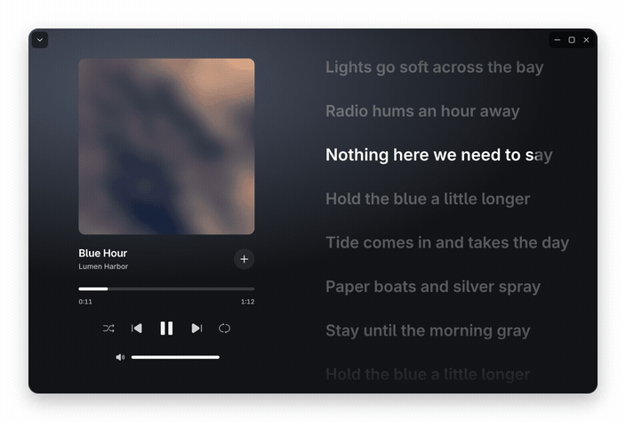</picture>

<div align="center">

**The equalizer over a live spectrum.** Drag a band and hear it.

</div>

<picture><source media="(prefers-color-scheme: dark)" srcset=".github/readme/shots/eq-dark.gif">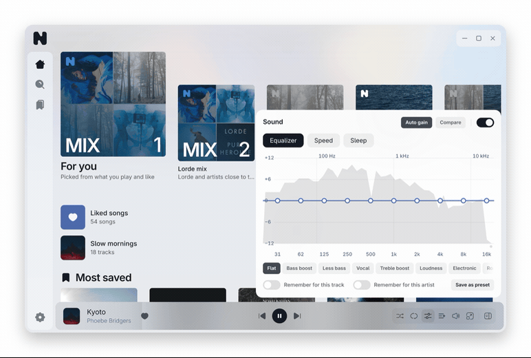</picture>

<div align="center">

**Home.** Nuvo builds these mixes on your machine.

</div>

<picture><source media="(prefers-color-scheme: dark)" srcset=".github/readme/shots/home-dark.gif">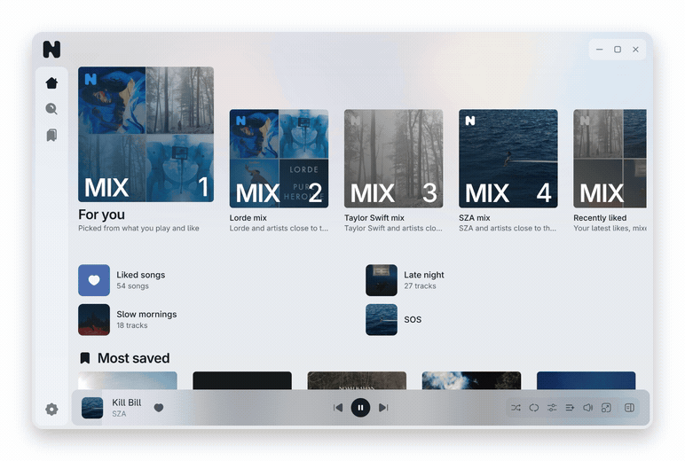</picture>

<div align="center">

**The queue.** Open it beside whatever you are doing.

</div>

<picture><source media="(prefers-color-scheme: dark)" srcset=".github/readme/shots/player-dark.gif">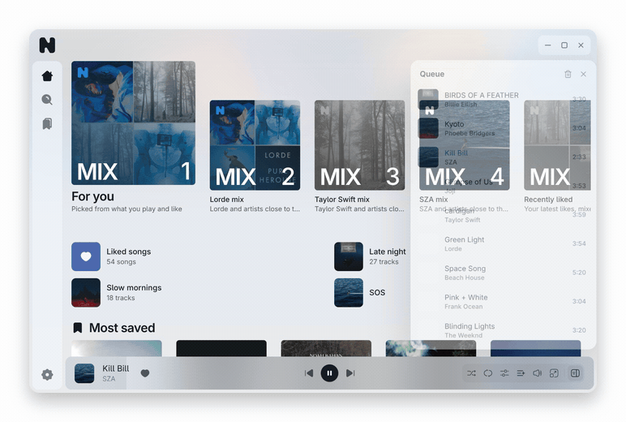</picture>

<div align="center">

**Your colours.** The app repaints while you pick.

</div>

<picture><source media="(prefers-color-scheme: dark)" srcset=".github/readme/shots/editor-dark.gif">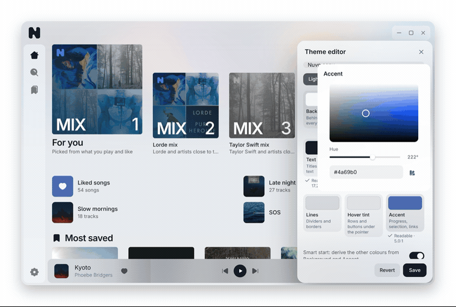</picture>

<div align="center">

**The tour.** It points at the real controls, one step at a time.

</div>

<picture><source media="(prefers-color-scheme: dark)" srcset=".github/readme/shots/tour-dark.gif">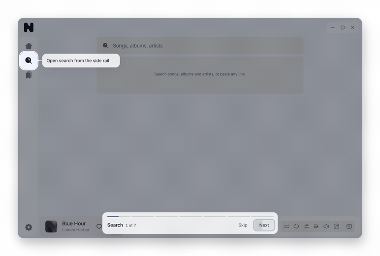</picture>

<br>

<a name="features"></a>

<picture><source media="(prefers-color-scheme: dark) and (max-width: 640px)" srcset=".github/readme/section-features-narrow-dark.svg"><source media="(max-width: 640px)" srcset=".github/readme/section-features-narrow-light.svg"><source media="(prefers-color-scheme: dark)" srcset=".github/readme/section-features-dark.svg"></picture>

<picture><source media="(prefers-color-scheme: dark) and (max-width: 640px)" srcset=".github/readme/band-a-narrow-dark.svg"><source media="(max-width: 640px)" srcset=".github/readme/band-a-narrow-light.svg"><source media="(prefers-color-scheme: dark)" srcset=".github/readme/band-a-dark.svg"></picture>

- Likes, saved albums and artists, playlists with custom covers, a duplicate finder
- Playlists you can merge, sort six ways, keep offline and restore after a delete, and pin to the sidebar
- Gapless playback, crossfade of 1 to 12 seconds, queue, shuffle, repeat, radio from any track
- Mixes on Home from your plays and likes, "Not interested" with undo, a dislike button on every song
- Statistics with a listening history, which you can pause, export or delete
- Media keys and MPRIS

<picture><source media="(prefers-color-scheme: dark) and (max-width: 640px)" srcset=".github/readme/band-b-narrow-dark.svg"><source media="(max-width: 640px)" srcset=".github/readme/band-b-narrow-light.svg"><source media="(prefers-color-scheme: dark)" srcset=".github/readme/band-b-dark.svg"></picture>

- Loudness normalization per track
- Speed and pitch with presets, reverb
- Sleep timer and A-B loop
- Moments to jump back to, trims for a song's start and end, and a choice of the source a song plays from

<picture><source media="(prefers-color-scheme: dark) and (max-width: 640px)" srcset=".github/readme/band-c-narrow-dark.svg"><source media="(max-width: 640px)" srcset=".github/readme/band-c-narrow-light.svg"><source media="(prefers-color-scheme: dark)" srcset=".github/readme/band-c-dark.svg"></picture>

- Paste LRC or plain text and tap to sync, per-track timing offset
- Karaoke highlight by line, word, fill or step
- Romanized lyrics for Korean, Chinese and Japanese kana (kanji stays as written)
- Translation through a local model on your machine
- Playlist links from YouTube, SoundCloud, Apple Music, Deezer and Spotify, and CSV (including Exportify files), JSON and M3U
- A long Spotify playlist or album comes in full when Spotify answers. If it does not, you get the first 100 songs and a notice

<picture><source media="(prefers-color-scheme: dark) and (max-width: 640px)" srcset=".github/readme/band-d-narrow-dark.svg"><source media="(max-width: 640px)" srcset=".github/readme/band-d-narrow-light.svg"><source media="(prefers-color-scheme: dark)" srcset=".github/readme/band-d-dark.svg"></picture>

- Tags, covers and `.lrc` files read from your folders
- Save streamed tracks as files, original or MP3, and export playlists and the library
- Paste links from Apple Music, Deezer, Yandex Music (songs), Shazam or TikTok, and share compact links
- Recognize a song from a video link (YouTube, TikTok, SoundCloud and more), a file or the microphone
- Last.fm scrobbling (with your own API key, off until you turn it on) and a Discord status (on by default, switch it off in Settings)

<picture><source media="(prefers-color-scheme: dark) and (max-width: 640px)" srcset=".github/readme/band-e-narrow-dark.svg"><source media="(max-width: 640px)" srcset=".github/readme/band-e-narrow-light.svg"><source media="(prefers-color-scheme: dark)" srcset=".github/readme/band-e-dark.svg"></picture>

- SQLCipher database, encrypted audio cache, key in your system keyring
- Local API on a private unix socket with a per-launch token
- Network check, HTTP, HTTPS and SOCKS5 proxy
- The update check contacts github.com. It is on by default, and you can turn it off in Settings, About

<a name="themes"></a>

<picture><source media="(prefers-color-scheme: dark) and (max-width: 640px)" srcset=".github/readme/section-themes-narrow-dark.svg"><source media="(max-width: 640px)" srcset=".github/readme/section-themes-narrow-light.svg"><source media="(prefers-color-scheme: dark)" srcset=".github/readme/section-themes-dark.svg"></picture>

<picture><source media="(prefers-color-scheme: dark)" srcset=".github/readme/shots/themes-dark.webp">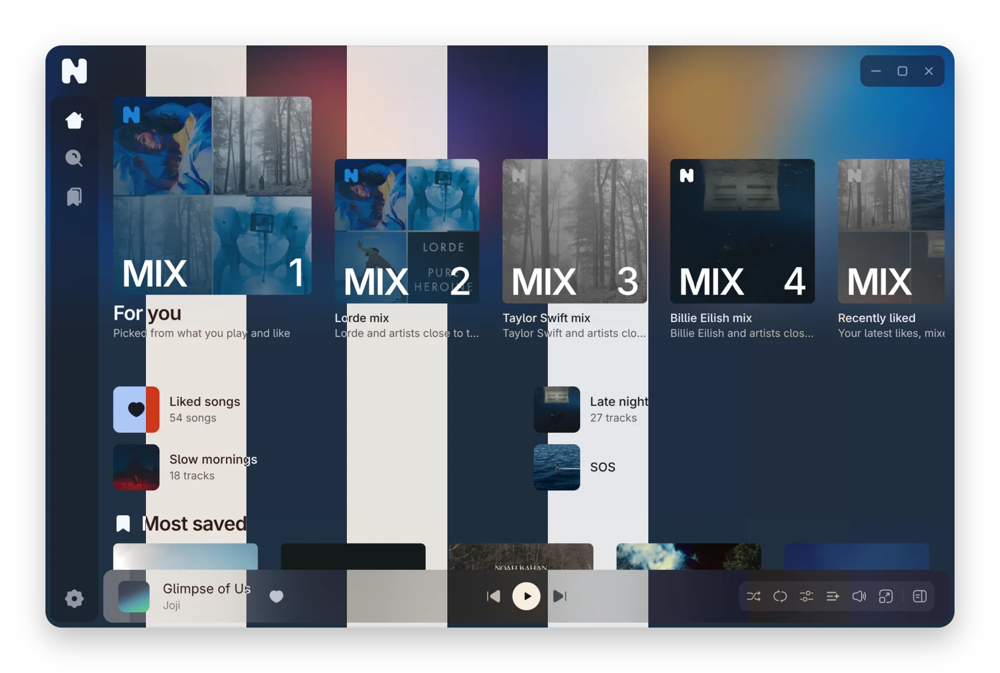</picture>

- A colour editor with contrast checks, theme files, system or custom fonts
- Custom CSS with a strict checker and a safe mode, wallpaper with glass blur
- The Notch on KDE, Hyprland, Sway and X11, and a panel widget for GNOME, Plasma and Waybar where the Notch cannot be pinned
- A tray, rebindable shortcuts, window zoom, a reduce-effects switch, English and Russian
- What's new after an update and Report a problem, both in Settings

<br>

<a name="how-it-works"></a>

<picture><source media="(prefers-color-scheme: dark) and (max-width: 640px)" srcset=".github/readme/section-how-narrow-dark.svg"><source media="(max-width: 640px)" srcset=".github/readme/section-how-narrow-light.svg"><source media="(prefers-color-scheme: dark)" srcset=".github/readme/section-how-dark.svg"></picture>

```text
Window (Electron renderer, React)      screens, playback engine, equalizer
  │  IPC
Electron main                          tray, the Notch, file dialogs, security policy
  │  unix socket, bearer token
nuvo-core (Rust)                       library, ranking, imports, local files, lyrics, caches
  ├── library.db                       SQLCipher, key in your system keyring
  ├── audio cache                      XChaCha20-Poly1305
  └── network                          YouTube, SoundCloud, LRCLIB, link APIs
```

- `src/` is the window: screens, playback engine, lyrics.
- `electron/` is the main process: tray, Notch, policy.
- `core/` is the Rust workspace behind `nuvo-core`.

More in [the architecture overview](https://nuvo.quest/docs/architecture/overview).

<br>

<a name="comparison"></a>

<picture><source media="(prefers-color-scheme: dark) and (max-width: 640px)" srcset=".github/readme/section-compare-narrow-dark.svg"><source media="(max-width: 640px)" srcset=".github/readme/section-compare-narrow-light.svg"><source media="(prefers-color-scheme: dark)" srcset=".github/readme/section-compare-dark.svg"></picture>

<picture><source media="(prefers-color-scheme: dark) and (max-width: 640px)" srcset=".github/readme/compare-matrix-playback-and-sound-narrow-dark.svg"><source media="(max-width: 640px)" srcset=".github/readme/compare-matrix-playback-and-sound-narrow-light.svg"><source media="(prefers-color-scheme: dark)" srcset=".github/readme/compare-matrix-playback-and-sound-dark.svg"></picture>

<picture><source media="(prefers-color-scheme: dark) and (max-width: 640px)" srcset=".github/readme/compare-matrix-lyrics-narrow-dark.svg"><source media="(max-width: 640px)" srcset=".github/readme/compare-matrix-lyrics-narrow-light.svg"><source media="(prefers-color-scheme: dark)" srcset=".github/readme/compare-matrix-lyrics-dark.svg"></picture>

<picture><source media="(prefers-color-scheme: dark) and (max-width: 640px)" srcset=".github/readme/compare-matrix-discovery-narrow-dark.svg"><source media="(max-width: 640px)" srcset=".github/readme/compare-matrix-discovery-narrow-light.svg"><source media="(prefers-color-scheme: dark)" srcset=".github/readme/compare-matrix-discovery-dark.svg"></picture>

<picture><source media="(prefers-color-scheme: dark) and (max-width: 640px)" srcset=".github/readme/compare-matrix-search-links-and-sharing-narrow-dark.svg"><source media="(max-width: 640px)" srcset=".github/readme/compare-matrix-search-links-and-sharing-narrow-light.svg"><source media="(prefers-color-scheme: dark)" srcset=".github/readme/compare-matrix-search-links-and-sharing-dark.svg"></picture>

<picture><source media="(prefers-color-scheme: dark) and (max-width: 640px)" srcset=".github/readme/compare-matrix-library-and-files-narrow-dark.svg"><source media="(max-width: 640px)" srcset=".github/readme/compare-matrix-library-and-files-narrow-light.svg"><source media="(prefers-color-scheme: dark)" srcset=".github/readme/compare-matrix-library-and-files-dark.svg"></picture>

<picture><source media="(prefers-color-scheme: dark) and (max-width: 640px)" srcset=".github/readme/compare-matrix-look-and-feel-narrow-dark.svg"><source media="(max-width: 640px)" srcset=".github/readme/compare-matrix-look-and-feel-narrow-light.svg"><source media="(prefers-color-scheme: dark)" srcset=".github/readme/compare-matrix-look-and-feel-dark.svg"></picture>

<picture><source media="(prefers-color-scheme: dark) and (max-width: 640px)" srcset=".github/readme/compare-matrix-privacy-and-system-narrow-dark.svg"><source media="(max-width: 640px)" srcset=".github/readme/compare-matrix-privacy-and-system-narrow-light.svg"><source media="(prefers-color-scheme: dark)" srcset=".github/readme/compare-matrix-privacy-and-system-dark.svg"></picture>

<details>
<summary><b>All 102 rows as plain tables</b></summary>

<br>

**102 features in Nuvo.** Each row is a Nuvo feature. *unknown* means we found no source; it is not a no.

#### Playback and sound (22)

| Feature | Nuvo | Riff | Liner | Spotify | YouTube Music | Apple Music | Strawberry |
|---|---|---|---|---|---|---|---|
| Now-playing bar with seek, volume and track info | Yes | Yes | Yes | Yes | *unknown* | *unknown* | Yes |
| Queue panel (play next, add to queue) | Yes | Yes | Yes | Yes | *unknown* | Yes | *unknown* |
| Shuffle and repeat (off, all, one) | Yes | Yes | Yes | Yes | *unknown* | Yes | *unknown* |
| Radio from a song or artist | Yes | Yes | Yes | *unknown* | *unknown* | Partly | *unknown* |
| Autoplay similar songs | Yes | Yes | Yes | *unknown* | *unknown* | *unknown* | *unknown* |
| Crossfade and gapless transitions | Yes | Partly | No | Yes | *unknown* | Yes | *unknown* |
| Loudness normalization and auto gain | Yes | Yes | No | Yes | *unknown* | Yes | Yes |
| Output device choice | Yes | Yes | *unknown* | *unknown* | *unknown* | *unknown* | *unknown* |
| Best quality switch | Yes | Yes | *unknown* | *unknown* | *unknown* | *unknown* | *unknown* |
| 10-band equalizer with 12 presets | Yes | Yes | Partly | Partly | *unknown* | *unknown* | Yes |
| Speed, pitch and reverb presets (slowed, nightcore, daycore) | Yes | Yes | Yes | Partly | *unknown* | *unknown* | *unknown* |
| Sleep timer | Yes | Yes | No | Partly | Yes | *unknown* | *unknown* |
| A-B loop (set start, set end, clear) | Yes | No | No | *unknown* | *unknown* | *unknown* | *unknown* |
| Pause on device change | Yes | *unknown* | Yes | *unknown* | *unknown* | *unknown* | *unknown* |
| Double-click and default playback context options | Yes | *unknown* | Yes | *unknown* | *unknown* | *unknown* | *unknown* |
| Offline mode | Yes | *unknown* | *unknown* | *unknown* | *unknown* | *unknown* | *unknown* |
| Saved audio with a cache size limit | Yes | Yes | Yes | Partly | Partly | Partly | Yes |
| Keep this version / Not this one (fix a wrong match) | Yes | *unknown* | *unknown* | *unknown* | *unknown* | *unknown* | *unknown* |
| Media keys and MPRIS | Yes | Partly | Partly | *unknown* | *unknown* | *unknown* | Yes |
| Moments: mark a place in a song and jump back to it | Yes | *unknown* | *unknown* | *unknown* | *unknown* | *unknown* | *unknown* |
| Trim a song's start and end | Yes | *unknown* | *unknown* | *unknown* | *unknown* | *unknown* | *unknown* |
| Choose which source a song plays from | Yes | *unknown* | *unknown* | *unknown* | *unknown* | *unknown* | *unknown* |

#### Lyrics (8)

| Feature | Nuvo | Riff | Liner | Spotify | YouTube Music | Apple Music | Strawberry |
|---|---|---|---|---|---|---|---|
| Synced lyrics pane | Yes | Yes | Yes | Yes | Yes | Yes | *unknown* |
| Karaoke view | Yes | Yes | Yes | *unknown* | *unknown* | Yes | *unknown* |
| Lyrics timing offset | Yes | Yes | Yes | *unknown* | *unknown* | *unknown* | *unknown* |
| Romanized lyrics | Yes | *unknown* | *unknown* | *unknown* | *unknown* | *unknown* | *unknown* |
| Lyrics editor: paste and time your own lyrics | Yes | Yes | No | *unknown* | *unknown* | *unknown* | *unknown* |
| Lyrics translation on your machine | Yes | Partly | No | *unknown* | *unknown* | *unknown* | *unknown* |
| Lyrics version choice (plain, line, word) | Yes | Partly | *unknown* | *unknown* | *unknown* | *unknown* | *unknown* |
| Karaoke highlight modes (line, word, fill, step) | Yes | Partly | Partly | *unknown* | *unknown* | *unknown* | *unknown* |

#### Discovery (13)

| Feature | Nuvo | Riff | Liner | Spotify | YouTube Music | Apple Music | Strawberry |
|---|---|---|---|---|---|---|---|
| Mixes on Home (for you, something new, artist mixes) | Yes | Yes | Yes | *unknown* | *unknown* | *unknown* | *unknown* |
| Recently liked and most saved shelves | Yes | Partly | *unknown* | *unknown* | *unknown* | *unknown* | *unknown* |
| Pin to Home | Yes | *unknown* | *unknown* | *unknown* | *unknown* | *unknown* | *unknown* |
| Reasons shown for recommendations | Yes | *unknown* | *unknown* | *unknown* | *unknown* | *unknown* | *unknown* |
| Not interested controls (exact song, any version, artist for a while or always) | Yes | Partly | No | Partly | Partly | *unknown* | *unknown* |
| Hidden music list with Show again | Yes | Yes | *unknown* | Partly | *unknown* | *unknown* | *unknown* |
| Start with a few artists you like | Yes | Partly | *unknown* | *unknown* | *unknown* | *unknown* | *unknown* |
| Playlist suggestions | Yes | Yes | *unknown* | *unknown* | *unknown* | *unknown* | *unknown* |
| Recognize a song (microphone, this computer or a file) with history | Yes | *unknown* | *unknown* | *unknown* | *unknown* | *unknown* | *unknown* |
| Statistics page: story, charts, top lists and drill-downs | Yes | *unknown* | *unknown* | *unknown* | *unknown* | *unknown* | *unknown* |
| Export, delete and pause your statistics | Yes | *unknown* | *unknown* | *unknown* | *unknown* | *unknown* | *unknown* |
| Dislike button on every song | Yes | *unknown* | *unknown* | *unknown* | *unknown* | *unknown* | *unknown* |
| Listening history with filters | Yes | *unknown* | *unknown* | *unknown* | *unknown* | *unknown* | *unknown* |

#### Search, links and sharing (6)

| Feature | Nuvo | Riff | Liner | Spotify | YouTube Music | Apple Music | Strawberry |
|---|---|---|---|---|---|---|---|
| Search for songs, albums, artists and playlists | Yes | Yes | Yes | Yes | *unknown* | *unknown* | *unknown* |
| Search history | Yes | *unknown* | Yes | *unknown* | *unknown* | *unknown* | *unknown* |
| Paste a link to play or import (YouTube Music, Apple Music, Deezer, SoundCloud) | Yes | Yes | Yes | *unknown* | *unknown* | *unknown* | *unknown* |
| Song from a TikTok link or video, found by listening | Yes | Partly | *unknown* | *unknown* | *unknown* | *unknown* | *unknown* |
| Share links and copy list | Yes | Yes | Yes | Yes | *unknown* | Yes | *unknown* |
| Command palette | Yes | *unknown* | *unknown* | *unknown* | *unknown* | *unknown* | *unknown* |

#### Library and files (26)

| Feature | Nuvo | Riff | Liner | Spotify | YouTube Music | Apple Music | Strawberry |
|---|---|---|---|---|---|---|---|
| Library tabs: playlists, albums, artists, on this computer | Yes | Yes | Yes | Yes | *unknown* | *unknown* | *unknown* |
| Grid and list view with filter | Yes | *unknown* | *unknown* | *unknown* | *unknown* | *unknown* | *unknown* |
| Liked songs | Yes | Yes | Yes | Yes | Yes | *unknown* | *unknown* |
| Create and delete playlists | Yes | Yes | Yes | *unknown* | *unknown* | Yes | Yes |
| Change playlist cover | Yes | Partly | *unknown* | *unknown* | *unknown* | *unknown* | *unknown* |
| Duplicate finder and tidy with undo | Yes | *unknown* | *unknown* | *unknown* | *unknown* | *unknown* | *unknown* |
| Sort tracks by title or length | Yes | Yes | Yes | Yes | *unknown* | Yes | *unknown* |
| Select several songs for bulk actions | Yes | Yes | *unknown* | *unknown* | *unknown* | *unknown* | *unknown* |
| Local music folders with watching and .lrc files | Yes | Yes | Partly | Partly | Partly | Partly | Yes |
| Import a playlist from a link | Yes | Yes | Yes | *unknown* | *unknown* | *unknown* | *unknown* |
| Import SoundCloud likes | Yes | *unknown* | *unknown* | *unknown* | *unknown* | *unknown* | *unknown* |
| Import a Spotify export file (CSV) | Yes | *unknown* | *unknown* | *unknown* | *unknown* | *unknown* | *unknown* |
| Import report with match review | Yes | *unknown* | Yes | *unknown* | *unknown* | *unknown* | *unknown* |
| Export playlists as CSV, JSON or M3U8 | Yes | Partly | *unknown* | *unknown* | *unknown* | *unknown* | *unknown* |
| Export the library as CSV or JSON | Yes | Partly | *unknown* | *unknown* | *unknown* | *unknown* | *unknown* |
| Save songs as files | Yes | Yes | Partly | *unknown* | *unknown* | *unknown* | *unknown* |
| Artist page | Yes | Partly | Yes | *unknown* | *unknown* | *unknown* | *unknown* |
| Album page | Yes | Yes | Yes | *unknown* | *unknown* | *unknown* | *unknown* |
| YouTube account sign-in, playback and playlist sync | Yes | Yes | Yes | *unknown* | *unknown* | *unknown* | *unknown* |
| Import a Spotify playlist or album from its link | Yes | *unknown* | *unknown* | *unknown* | *unknown* | *unknown* | *unknown* |
| Keep a playlist offline | Yes | *unknown* | *unknown* | *unknown* | *unknown* | *unknown* | *unknown* |
| Merge playlists and move songs between them, with undo | Yes | *unknown* | *unknown* | *unknown* | *unknown* | *unknown* | *unknown* |
| Recently deleted playlists with Restore | Yes | *unknown* | *unknown* | *unknown* | *unknown* | *unknown* | *unknown* |
| Save format: original or MP3 | Yes | *unknown* | *unknown* | *unknown* | *unknown* | *unknown* | *unknown* |
| Pin a playlist, album or artist to the sidebar | Yes | *unknown* | *unknown* | *unknown* | *unknown* | *unknown* | *unknown* |
| Explicit mark on songs their source calls explicit | Yes | *unknown* | *unknown* | *unknown* | *unknown* | *unknown* | *unknown* |

#### Look and feel (17)

| Feature | Nuvo | Riff | Liner | Spotify | YouTube Music | Apple Music | Strawberry |
|---|---|---|---|---|---|---|---|
| Theme presets (nine) | Yes | Yes | Yes | *unknown* | *unknown* | *unknown* | *unknown* |
| Accent from the cover | Yes | Yes | *unknown* | *unknown* | *unknown* | *unknown* | *unknown* |
| Cover glow | Yes | Partly | Partly | *unknown* | *unknown* | *unknown* | *unknown* |
| Language choice (English, Russian) | Yes | Yes | Yes | Yes | *unknown* | *unknown* | Yes |
| Fonts and interface size | Yes | Yes | *unknown* | *unknown* | *unknown* | *unknown* | *unknown* |
| Theme editor with colour roles | Yes | Yes | No | *unknown* | *unknown* | *unknown* | *unknown* |
| Theme import and export | Yes | Partly | *unknown* | *unknown* | *unknown* | *unknown* | *unknown* |
| Custom CSS | Yes | Yes | No | *unknown* | *unknown* | *unknown* | *unknown* |
| Wallpaper with blur and dimming | Yes | Yes | Partly | *unknown* | *unknown* | *unknown* | *unknown* |
| Reset customization and safe mode | Yes | Partly | Partly | *unknown* | *unknown* | *unknown* | *unknown* |
| The Notch (mini player with lyrics and pulse) | Yes | Partly | Partly | *unknown* | *unknown* | Partly | *unknown* |
| Keep running in the tray | Yes | Yes | No | *unknown* | *unknown* | *unknown* | *unknown* |
| Rebindable shortcuts, in the app and global | Yes | Yes | Yes | *unknown* | *unknown* | *unknown* | Partly |
| Guided first-run tour | Yes | *unknown* | *unknown* | *unknown* | *unknown* | *unknown* | *unknown* |
| Reduce effects | Yes | *unknown* | *unknown* | *unknown* | *unknown* | *unknown* | *unknown* |
| Window zoom from the keyboard | Yes | *unknown* | *unknown* | *unknown* | *unknown* | *unknown* | *unknown* |
| Panel widget for GNOME, Plasma and Waybar | Yes | *unknown* | *unknown* | *unknown* | *unknown* | *unknown* | *unknown* |

#### Privacy and system (10)

| Feature | Nuvo | Riff | Liner | Spotify | YouTube Music | Apple Music | Strawberry |
|---|---|---|---|---|---|---|---|
| Encrypted library with recovery phrase unlock | Yes | No | No | *unknown* | *unknown* | *unknown* | *unknown* |
| Passphrase protection when no system keyring exists | Yes | *unknown* | No | *unknown* | *unknown* | *unknown* | *unknown* |
| Proxy setting | Yes | Partly | No | *unknown* | *unknown* | *unknown* | *unknown* |
| Connection check and report | Yes | Yes | Yes | *unknown* | *unknown* | *unknown* | *unknown* |
| Helper tools download (yt-dlp, ffmpeg) | Yes | Yes | *unknown* | *unknown* | *unknown* | *unknown* | *unknown* |
| Automatic updates | Yes | Yes | Yes | *unknown* | *unknown* | *unknown* | *unknown* |
| Last.fm scrobbling | Yes | *unknown* | *unknown* | *unknown* | *unknown* | *unknown* | *unknown* |
| Discord status switch | Yes | *unknown* | *unknown* | *unknown* | *unknown* | *unknown* | *unknown* |
| What's new after an update | Yes | *unknown* | *unknown* | *unknown* | *unknown* | *unknown* | *unknown* |
| Report a problem with a filled GitHub issue | Yes | *unknown* | *unknown* | *unknown* | *unknown* | *unknown* | *unknown* |

</details>

<details>
<summary><b>Notes and sources</b></summary>

<br>

- Unknown means we found no source we could cite. It does not mean the app lacks the feature, and it is never counted as a no.
- Yes and Partly cells have a source in .github/readme/comparison-sources.json. No cells rest on a repository we read or a limit the product's own docs state.
- Riff cells come from its README and settings page at commit 33fa5ff. Liner cells come from its README, docs and source at commit eea9a6a. Both may have changed since.
- Spotify, YouTube Music and Apple Music cells come from their help pages, except three cells sourced from SlashGear. Several rows carry over from an earlier pass whose source was not recorded; they are marked in the sources file.
- Nuvo: the Windows and macOS builds exist and are untested. Rows added on 2026-11-08 carry yes for Nuvo and unknown for the others: we did not look for them elsewhere.
- The rows are the features of the Nuvo app, so they favour Nuvo by construction. A feature another app has and Nuvo lacks is not listed here.

Checked 2026-11-07. Sources: [Riff](https://github.com/rootscripts/riff), [Liner](https://github.com/tryliner/desktop), [Strawberry](https://github.com/strawberrymusicplayer/strawberry), [Spotify help](https://support.spotify.com/), [YouTube Music help](https://support.google.com/youtubemusic), [Apple Music guide](https://support.apple.com/guide/music-windows/). If a cell is wrong, open an issue.

</details>

<picture><source media="(prefers-color-scheme: dark) and (max-width: 640px)" srcset=".github/readme/compare-chart-narrow-dark.svg"><source media="(max-width: 640px)" srcset=".github/readme/compare-chart-narrow-light.svg"><source media="(prefers-color-scheme: dark)" srcset=".github/readme/compare-chart-dark.svg"></picture>

<details>
<summary><b>Notes and sources for the speed table</b></summary>

<br>

| App | Idle memory | Processes | Idle CPU | Cold start | Playing CPU | Playing memory | Installed size |
|---|---|---|---|---|---|---|---|
| Nuvo | 381.1 MB (379.6 to 386.2) | 6 | 0.2 % (0.17 to 0.23) | 421 ms (411 to 462) | 2.7 % (2.6 to 2.75) | 443.8 MB (443 to 453.3) | 319.4 MB unpacked (AppImage 133.5, .deb 105.8) |
| Liner | 504.3 MB (502.2 to 505.1) | 8 | 1.2 % (1.17 to 1.23) | 1053 ms (966 to 1404) | not measured | not measured | 549.1 MB |
| Riff | 422.1 MB (421.4 to 422.6) | 7 | 10.87 % (10.67 to 11.2) | bimodal: 1628 to 9873 ms, median 9215 ms | not measured | not measured | 366.3 MB extracted (AppImage 132.8) |
| Spotify | 567 MB (558.4 to 568.6) | 9 | 1.5 % (0.43 to 2.07) | no usable-window figure: first window at 435 to 447 ms, probably a splash | not measured | not measured | 14.1 MB flatpak app, plus a shared runtime; first-run download not measured |
| YouTube Music | 544.5 MB (533.1 to 547.9) | 17 | 0.6 % (0.3 to 3.23) | 2999 ms (2108 to 4405), includes network | not measured | not measured | not measured |
| Apple Music | 673.7 MB (664 to 676.8) | 17 | 0.8 % (0.53 to 3.03) | 3157 ms (2173 to 3741), includes network | not measured | not measured | not measured |
| Strawberry | 128.7 MB (128.6 to 129.6) | 2 | 0.37 % (0.3 to 0.37) | 1132 ms (834 to 1342) | 1.3 % (1.27 to 1.37) | 136.8 MB (136.7 to 136.9) | 22.6 MB flatpak app, plus the KDE runtime (about 1.1 GB, shared) |

- **Machine and build.** AMD Ryzen 9 PRO 7945, 30 GB, Fedora, Linux 7.2.11, GNOME on Wayland. Measured on 2026-11-07. Nuvo is the 0.2.10 `linux-unpacked` package. Other programs were running on the machine all day.
- **Runs and labels.** 5 runs per figure, 6 for Spotify. Every app had its own empty profile and no login. Nuvo: empty profile, Home reached. Liner: sign-in screen. Riff 44.2.0: logged out. Spotify: logged-out client (flatpak). Strawberry 1.2.31: flatpak, empty library. YouTube Music and Apple Music: web tab, logged out, fresh Chrome 156 profile. Each run started a fresh process; the page cache was not dropped.
- **Idle.** Memory is PSS summed over the whole process tree (Nuvo includes its daemon), read 30 s after the window appeared. CPU is user plus system time of the tree over the next 30 s, in percent of one core.
- **Cold start.** The definitions differ, so read it as a rough guide. Nuvo, Liner, Riff and the web tabs: first frame with the window visible and text, read over the DevTools protocol. The web-tab figure includes the network. Spotify and Strawberry have no such hook: first mapped window of at least 200 by 200 pixels. Spotify's 435 to 447 ms window is probably a splash, so we give no start figure for it.
- **Playing.** Nuvo played a cached 90 s tone at volume 0 from a seeded playlist, CPU over seconds 40 to 60. Strawberry played a 240 s tone with its stream volume at 0, measured 30 s after the start. Different players and different moments, both whole-tree. Liner, Spotify, Riff and the web tabs are not measured: playback needs an account, and we did not attempt one.
- **Load.** One-minute load average under 1.2 at every sample for the other apps. Nuvo's late set had a median of 0.19 and a maximum of 0.29.
- **Nuvo's spread.** Idle memory moved between two sessions on the same build with no change: 336 MB in an earlier session, 381 MB in the later one, which is the figure above. The same shift of 40 to 45 MB showed in every Nuvo scenario, and we have not found the cause. Every other web-engine app still uses more memory than either figure.
- **Where Nuvo loses.** Strawberry uses less memory at idle (129 against 381 MB) and less CPU while playing (1.3 against 2.7 %). It is a native Qt player; Nuvo is Electron with a Rust daemon. Strawberry's installed size depends on a shared runtime of about 1.1 GB. Riff's start is bimodal and we have not found why.
- **Published, not measured by us.** Riff's README claims about 180 MB during playback, with no method given ([source](https://github.com/rootscripts/riff#memory-usage), read 2026-11-07). We measured 422 MB at idle on the AppImage. Other published figures, such as download sizes, are in `.github/readme/published.json`.
- **Not measured.** Installed size of the web tabs, a start with a dropped page cache, other machines. Nothing here is estimated.

</details>

We publish a number only when we measured the apps the same way on the same day. Everything else says "not measured".

<br>

<a name="install"></a>

<div align="center">

<a href="https://github.com/Ziuziuk-Denys/nuvo/releases/latest"><picture><source media="(prefers-color-scheme: dark) and (max-width: 640px)" srcset=".github/readme/banner-download-narrow-dark.svg"><source media="(max-width: 640px)" srcset=".github/readme/banner-download-narrow-light.svg"><source media="(prefers-color-scheme: dark)" srcset=".github/readme/banner-download-dark.svg"></picture></a>

</div>

Get an AppImage, `.deb` or `.rpm` from the [releases page](https://github.com/Ziuziuk-Denys/nuvo/releases). Windows and macOS builds are there too, and we have not tested them. You need a Secret Service keyring such as GNOME Keyring or KWallet.

Builds are unsigned for now. Code signing costs money every year and Nuvo is free, so your system may warn you the first time:

- **Windows:** in SmartScreen, choose **More info**, then **Run anyway**.
- **macOS:** open Nuvo once, go to **System Settings**, **Privacy & Security**, and press **Open Anyway**.
- **Linux:** make the AppImage executable and run it.

Each release lists SHA-256 checksums. Full steps and building from source: [the install guide](https://nuvo.quest/docs/install).

<br>

<a name="roadmap"></a>

<picture><source media="(prefers-color-scheme: dark) and (max-width: 640px)" srcset=".github/readme/section-roadmap-narrow-dark.svg"><source media="(max-width: 640px)" srcset=".github/readme/section-roadmap-narrow-light.svg"><source media="(prefers-color-scheme: dark)" srcset=".github/readme/section-roadmap-dark.svg"></picture>

This is what comes next, and it is not a schedule. Details in [the roadmap](https://nuvo.quest/docs/roadmap).

<br>

<div align="center">

<a href="https://nuvo.quest/donate"><picture><source media="(prefers-color-scheme: dark) and (max-width: 640px)" srcset=".github/readme/banner-support-narrow-dark.svg"><source media="(max-width: 640px)" srcset=".github/readme/banner-support-narrow-light.svg"><source media="(prefers-color-scheme: dark)" srcset=".github/readme/banner-support-dark.svg"></picture></a>

<br>

<a href="https://t.me/getnuvo"><picture><source media="(prefers-color-scheme: dark) and (max-width: 640px)" srcset=".github/readme/banner-telegram-narrow-dark.svg"><source media="(max-width: 640px)" srcset=".github/readme/banner-telegram-narrow-light.svg"><source media="(prefers-color-scheme: dark)" srcset=".github/readme/banner-telegram-dark.svg"></picture></a>

</div>

<br>

## Documentation

The docs live on [the Nuvo site](https://nuvo.quest/docs). Start with [the introduction](https://nuvo.quest/docs/introduction).

## Contributing and security

[CONTRIBUTING.md](CONTRIBUTING.md), [SECURITY.md](SECURITY.md), [CODE_OF_CONDUCT.md](CODE_OF_CONDUCT.md).

## Licence

Nuvo is licensed under the [GNU AGPL-3.0-or-later](LICENSE). [LICENSING.md](LICENSING.md) has a plain summary. A commercial licence is available from the author. [TRADEMARKS.md](TRADEMARKS.md) covers the name and mark. [THIRD-PARTY-NOTICES](THIRD-PARTY-NOTICES) lists third-party software and icon sets.

<sub>The artwork is generated by [.github/readme/build.py](.github/readme/build.py) from [data.json](.github/readme/data.json). Screens are real captures of the app. Album art belongs to its owners and appears only to show the interface. The karaoke song and its lines are invented for this page. Headline type is Figtree, under the SIL Open Font License. Tech icons are from [skill-icons](https://github.com/tandpfun/skill-icons) (MIT), and the two badges from [shields.io](https://shields.io).</sub>
